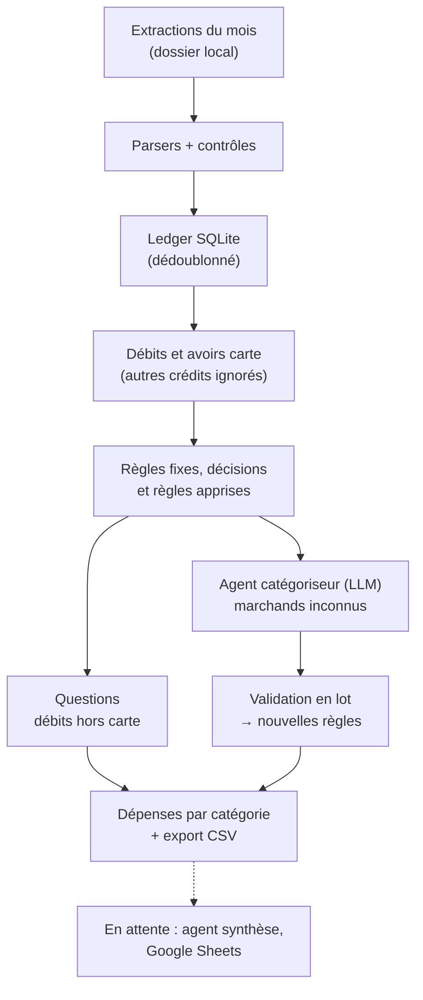

# Cadrage — Budget Tracker agentique (Projet 2)

Sep 23, 2026 · @Antoine · Révisé le 15 oct. 2026

> **Recadrage du 15 octobre 2026.** Après le premier test sur données réelles, le périmètre est réduit au suivi des dépenses. Les revenus, les virements entre comptes, les dotations, la provision, les contrôles d'équilibre des flux et les natures de flux sont abandonnés. Seuls les débits sont suivis : chacun reçoit une sous-catégorie ou est déclaré « non compté ». Les avoirs carte restent déduits de leur catégorie. Les étapes 9 et 10 sont en attente, et la spec 08 sera réécrite.

## 1. Contexte et objectifs

Chaque mois, l'agent transforme trois extractions bancaires en un suivi des dépenses du foyer, avec une vue compte joint et une vue compte perso.

**Objectif d'apprentissage** : pratiquer avec PydanticAI la sortie structurée et le human-in-the-loop persistant (mémoire des décisions).

**Objectif fonctionnel** : répondre chaque mois à trois questions.

1. Combien dépense-t-on ce mois-ci, en joint et en perso ?
2. Quelle catégorie pèse le plus ?
3. Comment les dépenses évoluent-elles d'un mois à l'autre ?

**Posture assumée** : l'essentiel du projet est de l'ETL déterministe (parsing, contrôles, totaux). Le LLM catégorise les marchands carte inconnus. Un agent de synthèse pourra commenter les chiffres calculés par le code (étape 8, en attente).

## 2. Périmètre

L'outil est lancé à la main et pose ses questions dans le terminal.

**MVP**

- Import des trois extractions d'un mois depuis un dossier local.
- Parsing déterministe avec contrôles bloquants, puis stockage dans un ledger SQLite dédoublonné.
- Suivi des débits seulement. Les crédits sont ignorés, sauf les avoirs carte, déduits de leur catégorie.
- Catégorisation des paiements carte : règles, puis proposition du LLM, puis validation en lot.
- Question sur tout autre débit non couvert par une règle : sous-catégorie ou « non compté ».
- Mémoire des décisions : chaque réponse peut devenir une règle réutilisable.
- Dépenses du mois par catégorie dans le terminal, et export CSV.

**En attente (étapes 8 à 10)** : synthèse rédigée par le LLM, publication Google Sheets, import de l'historique.

**Phase 2**

- Dépôt des extractions sur Google Drive et déclenchement automatique par surveillance du dossier.
- Agent analyste doté d'outils de lecture du ledger, pour creuser le « pourquoi » d'une hausse.

**Hors périmètre**

- Revenus, épargne, virements entre comptes et équilibre des flux du foyer.
- Import du compte perso de Sarah, du compte épargne, des livrets et des enveloppes PEA/CTO.
- Vue consolidée du foyer (joint et perso additionnés).
- Suivi de patrimoine et de performance des investissements.

## 3. Sources de données

Les trois sources sont parsables de façon déterministe, et chacune dispose d'un contrôle de cohérence. Les deux contrôles chiffrés ont été vérifiés sur les fichiers de juin 2026.

Tout est lu et contrôlé, crédits compris, car le contrôle de solde Trade Republic en a besoin. Les crédits ne sont écartés qu'ensuite (RG-19).

| Source | Format | Période couverte | Volume (juin) | Contrôle bloquant |
| --- | --- | --- | --- | --- |
| CA cartes (X1091, X1481) | CSV cp1252, séparateur `;`, une section par carte | Achats du 19 M-1 au 18 M environ, débités fin M | 48 opérations | Net de chaque carte égal à la ligne « Prélèvement carte » du joint, au centime (3 116,50 € et 410,67 € : OK) |
| CA compte joint | CSV cp1252, `;`, libellés multi-lignes | Du 1er à la fin du mois M | 38 opérations | Chaque ligne a une date et un seul montant ; une ligne de débit différé par carte |
| Trade Republic compte courant | PDF de 8 pages contenant 3 relevés (compte courant et 2 PEA) | Du 1er à la fin du mois M | 74 opérations | Solde recalculé ligne à ligne, et totaux égaux à la synthèse du relevé (entrées 993,71 €, sorties 1 435,36 €) |

**Pièges du Crédit Agricole**

- Encodage cp1252, fins de ligne CRLF et LF mélangées, blocs d'en-tête à ignorer, une section par carte.
- Libellé du joint sur plusieurs lignes : la ligne 1 donne le type d'opération, la ligne 2 le détail, les suivantes les références SEPA (RUM, identifiant créancier ICS).
- Montants hétérogènes : `550`, `4,8`, `1 071,04`, et `-3 116.50` avec un point dans l'en-tête des cartes.
- Des lignes de l'ancienne carte X9817 peuvent encore apparaître sur le joint (avoir, remboursement de cotisation). Ce sont des crédits du joint : ils sont ignorés.

**Pièges de Trade Republic**

- Le parsing texte naïf est exclu : « CARREFOUR CITY 2466078 6,45 € » est lu comme 24 660 786,45 €.
- Le parsing se fait par position de colonne, en repérant l'abscisse des en-têtes ENTRÉE, SORTIE et SOLDE sur chaque page. Le prototype a lu 73 opérations sur 74, et le contrôle de solde a détecté la 74e (DECATHLON 409,97 €).
- Le type « Avoir » désigne tout paiement carte, dans les deux sens. Le sens se lit dans la colonne, jamais dans le type.
- Dates et descriptions s'étalent sur deux lignes. Les sections PEA sont ignorées.

**Complétude** : un mois M ne peut être traité qu'une fois ses trois fichiers présents, c'est-à-dire à partir du 1er du mois M+1.

## 4. Modèle de classement

Chaque débit reçoit soit une sous-catégorie, soit le statut « non compté ». Un débit non compté reste dans le ledger, mais n'entre dans aucun total. C'est le seul choix laissé à l'utilisateur : le reste est automatique.

**Traitement par type d'opération**

| Opération | Traitement | Exemples de juin |
| --- | --- | --- |
| Paiement carte : fichier cartes CA, ou « Avoir » TR en sortie | Sous-catégorie par règle marchand, sinon proposition du LLM et validation en lot | Carrefour, Uber Eats, Decathlon |
| Avoir carte : paiement carte en entrée | Sous-catégorie de son marchand, en déduction (RG-09) | Manomano +199,99 €, Zalando +51 € |
| Autre débit du joint ou de TR | Règle apprise, sinon question : sous-catégorie ou non compté (RG-06) | Prêt, Octopus Energy, PayPal, virement « Mensuel » vers TR |
| Ligne de débit différé du joint | Neutralisée d'office, car remplacée par le détail des cartes (RG-03) | Prélèvement carte de 3 116,50 € |
| Ordre ou versement PEA sur TR | Non compté d'office (RG-11) | DCA 10 €, arrondi 5,25 € |
| Tout autre crédit | Ignoré (RG-19) | Salaires, remboursement de mutuelle, virements reçus |

**Catégories**

| Catégorie | Sous-catégories | Exemples |
| --- | --- | --- |
| Logement | Prêt · Charges & assurances · Énergie · Autre | Mensualités et assurance emprunteur ; copropriété, assurance habitation ; électricité, gaz, eau ; travaux, bricolage |
| Courses | Supermarché · Commerces · Autre | Carrefour, Intermarché ; boulangerie, boucherie, primeur |
| Restos | Restaurant · Livraison · Autre | Restaurants, cafés ; Uber Eats, Deliveroo |
| Loisirs | Sorties · Sport · Vacances · Autre | Cinéma, musées ; Decathlon, club ; Airbnb, Booking |
| Achats | Vêtements · Maison · Tech · Cadeaux · Autre | H&M ; Ikea, déco ; informatique, téléphonie ; cadeaux offerts ; Amazon sous 50 € |
| Enfants | Garde/scolaire · Activités · Autre | Crèche, nounou, cantine ; activités ; équipement, jouets |
| Transport | Voiture · Transports en commun · Train/avion · Autre | Carburant, parking, péages, entretien ; Navigo ; SNCF, billets d'avion ; taxi, VTC |
| Abonnements | Internet · Streaming · Logiciels · Banque · Autre | Box, forfait mobile ; Spotify, Netflix ; logiciels, IA ; offre bancaire, cotisation carte |
| Santé | Pharmacie · Médecins · Autre | Pharmacie ; consultations ; optique |
| Divers | Impôts · Autre | Impôt sur le revenu, taxe foncière ; tout le reste |

Chaque catégorie a une sous-catégorie « Autre », pour ne jamais hésiter. La distinction Fixe/Pilotable est abandonnée.

## 5. Comptes suivis

| Compte | Banque | Vue | Opérations suivies |
| --- | --- | --- | --- |
| Compte joint | Crédit Agricole, cartes X1091 et X1481 | Joint | Paiements carte et autres débits du compte |
| Compte perso d'Antoine | Trade Republic | Perso | Paiements carte et autres débits, hors investissements |

Les virements entre comptes ne sont pas suivis comme tels. Le virement mensuel du joint vers Trade Republic est un débit du joint, déclaré non compté. Les dépenses qu'il finance apparaissent dans la vue perso, sous forme de paiements carte TR.

Une dépense n'est ainsi comptée qu'une fois, là où elle est payée. Pour la même raison, un virement qui finance une dépense précise sur l'autre compte est en principe non compté.

## 6. Règles de gestion

Les règles conservées gardent leur numéro, pour que les références dans le code et les tests restent valides.

| ID | Règle | Exemple |
| --- | --- | --- |
| RG-01 | Le mois budgétaire est le mois de débit. La date d'achat est conservée dans le ledger. | Le fichier CB de juin, débité le 30/06, compte pour juin même avec des achats du 23/05. |
| RG-02 | Un mois n'est traité que si ses trois extractions sont présentes et tous les contrôles sont passés. | Il manque le PDF TR : arrêt avec un message explicite. |
| RG-03 | Les lignes de débit différé du joint sont neutralisées et remplacées par le détail des cartes. Tout écart différent de 0 € arrête le traitement. | Carte X1091 : 3 116,50 € de chaque côté. |
| RG-06 | Tout débit hors paiement carte, sans décision ni règle, déclenche une question : sous-catégorie ou non compté. | Prélèvement Octopus Energy de 68,92 € : Logement › Énergie, avec une règle sur l'identifiant créancier. |
| RG-09 | Un avoir carte reçoit la sous-catégorie de son marchand et se déduit de son total. | Manomano −199,99 € puis +199,99 € : 0 € en Achats. |
| RG-10 | Un débit déclaré non compté reste dans le ledger, mais n'entre dans aucun total. | Virements de 500 € « Mensuel » vers TR et de 400 € vers Sarah. |
| RG-11 | Sur Trade Republic, les exécutions d'ordres et les versements PEA sont non comptés d'office. | DCA 10 €, arrondi 5,25 €. |
| RG-12 | Le sens d'une opération Trade Republic se lit dans sa colonne, jamais dans son type. | Zalando 51 € en entrée, de type « Avoir » : c'est un avoir carte (RG-09). |
| RG-13 | Amazon sous 50 € va en Achats › Autre ; à partir de 50 €, question sur la ligne, jamais de règle. | 49,72 € classé automatiquement ; 78,38 € soumis. |
| RG-14 | PayPal et chèques déclenchent toujours une question, sans règle possible. | PayPal 25 € le 04/06. |
| RG-16 | Clé de dédoublonnage : source, date, montant, libellé normalisé et rang d'occurrence. Un réimport n'a aucun effet. | Deux cafés VARENNE CAFE à 6,80 € le 24/06 : rangs 1 et 2. |
| RG-19 | Seuls les débits sont suivis. Les crédits sont lus et contrôlés, puis ignorés, sauf les avoirs carte (RG-09). | Salaires, remboursement de mutuelle de 77,90 € : ignorés. |

**Règles retirées au recadrage** : RG-04 (salaires), RG-05 (dotations), RG-07 (liens à une dépense), RG-08 (provision), RG-15 (exceptionnels), RG-17 (carte inconnue), RG-18 (charges fixes attendues).

## 7. Mémoire et interaction humaine

Une question tranchée ne revient jamais : chaque réponse devient soit une règle réutilisable, soit une décision rattachée à une seule opération.

**Ordre de classement d'une opération**

1. Règles fixes : crédits ignorés (RG-19), débit différé neutralisé (RG-03), ordres et PEA non comptés (RG-11), Amazon sous le seuil (RG-13).
2. Décision enregistrée pour l'opération.
3. Règle apprise la plus spécifique.
4. Pour un paiement carte d'un marchand inconnu : proposition du LLM.
5. Validation humaine dans le terminal : en lot pour les paiements carte, une question par opération pour les autres débits.

**Types de règles apprises**

| Type | Clé de correspondance | Exemple |
| --- | --- | --- |
| Prélèvement et autre débit | Identifiant créancier SEPA, libellé exact ou préfixe ; plage de montant optionnelle | `FR41ZZZ272230` → Logement › Charges & assurances |
| Virement | Libellé normalisé, avec montant exact ou plage obligatoire | « VIR INST vers ANTOINE GRUBERT - Mensuel », 500 € → non compté |
| Marchand carte | Clé marchand du libellé | CARREFOUR CITY → Courses › Supermarché |
| Toujours demander | Identifiant créancier ou libellé | PayPal, identifiant `LU96ZZZ0000000000000000058` |

**Priorité** : la règle la plus spécifique l'emporte. Un identifiant créancier prime sur un libellé exact, qui prime sur un préfixe ; une règle avec condition de montant prime sur une règle sans. Deux règles de même spécificité qui se contredisent sont refusées dès leur création.

**Pas de score de confiance du LLM** : l'auto-évaluation d'un LLM est mal calibrée. Chaque nouveau marchand est donc validé une fois. Le premier run sera chargé (environ 60 marchands distincts en juin), puis la charge décroît avec la couverture des règles.

**Déroulé dans le terminal**, en deux blocs :

1. **Débits hors carte**, un par un. Le menu propose les dix catégories et « Non compté », puis la sous-catégorie, puis « En faire une règle ? » (oui, non, toujours demander).
2. **Paiements carte** : un tableau des marchands inconnus avec la proposition du LLM. Entrée valide tout ; un numéro corrige une ligne, vers une autre sous-catégorie ou vers « non compté ». Chaque marchand validé devient une règle.

Une question couverte par une règle créée plus tôt dans le même dialogue est sautée : après la règle sur un premier virement vers Sarah, le second n'est pas reposé. `q` quitte à tout moment ; les réponses déjà données sont conservées.

**Stockage** : SQLite est la source de vérité (règles, questions, décisions, propositions du LLM). `budget rules list` et `budget rules disable <id>` servent à auditer la mémoire.

## 8. Restitution

**Disponible**

- À la fin de `budget classify` : les dépenses comptées du mois par catégorie, en vue joint et en vue perso, et le nombre d'opérations encore en attente.
- `budget export` écrit le CSV du mois. Il contient une ligne par débit et par avoir carte, avec ces colonnes : date d'opération, date de débit, compte, libellé, montant, catégorie, sous-catégorie, comptée (oui ou non) et règle appliquée.

**En attente (étapes 8 à 10)** : totaux sur plusieurs mois, commentaire de l'agent synthèse et publication Google Sheets. Leurs indicateurs seront redéfinis dans la spec 08 à partir de ce périmètre. Pistes : total par catégorie et par mois, écart à un budget par catégorie, évolution sur 12 mois.

## 9. Architecture technique

Le traitement est un pipeline Python dont une seule étape appelle le LLM. Il s'appuie sur PydanticAI v2, stable depuis le 23 juin 2026 ([politique de versions](https://pydantic.dev/docs/ai/project/version-policy/)).



Seul le nœud G appelle le modèle. Les questions sur les débits hors carte (nœud F) sont posées par du code, sans LLM.

**Stack**

| Composant | Choix | Raison |
| --- | --- | --- |
| Langage | Python 3.12 | `StrEnum`, typage moderne |
| Framework agent | `pydantic-ai` v2 | Sortie structurée typée, tests sans appel réseau, outils différés pour la phase 2 |
| Modèle | Claude Haiku 4.5 pour l'agent catégoriseur ; synthèse à définir avec l'étape 8 | Tâche courte et peu coûteuse |
| PDF | `pdfplumber` | Coordonnées des mots, approche validée sur juin |
| CSV | Module `csv` de la bibliothèque standard, lu en cp1252 | Gère nativement les libellés multi-lignes entre guillemets |
| Montants | `decimal.Decimal` | Jamais de `float` pour de l'argent |
| Stockage | SQLite | Ledger, règles, questions et décisions dans un seul fichier facile à sauvegarder |
| Contexte | YAML validé par un modèle Pydantic | Éditable à la main, erreurs détectées au chargement |
| Google Sheets | `gspread` (étape 9, en attente) | Simple pour les valeurs |
| CLI | Typer et Rich | Commandes et tableaux lisibles dans le terminal |

**Commandes**

- `budget import --mois 2026-06` : contrôle et importe les trois extractions du mois.
- `budget classify --mois 2026-06` : classe le mois, pose les questions et déroule la validation en lot.
- `budget export --mois 2026-06` : écrit le CSV du mois.
- `budget rules list` et `budget rules disable <id>` : audit de la mémoire.
- `budget config verifier` : validation du fichier de contexte.

**Modèle de données** (extrait)

```python
from datetime import date
from decimal import Decimal
from enum import StrEnum

from pydantic import BaseModel, Field


class SousCategorie(StrEnum):
    # Une seule énumération à plat : la catégorie parente se déduit du préfixe,
    # ce qui rend impossible un couple catégorie/sous-catégorie incohérent.
    COURSES_SUPERMARCHE = "courses.supermarche"
    RESTOS_LIVRAISON = "restos.livraison"
    LOGEMENT_PRET = "logement.pret"
    # ... liste complète : section 4


class Transaction(BaseModel):  # faits lus dans le fichier
    id: str  # clé de dédoublonnage (RG-16)
    source: str  # "ca_cb" | "ca_joint" | "tr"
    compte: str  # "joint" | "perso"
    date_operation: date
    mois_budgetaire: str = Field(pattern=r"^\d{4}-\d{2}$")  # RG-01
    libelle: str
    libelle_normalise: str
    type_operation: str | None = None  # 1re ligne CA ou colonne Type TR
    ics: str | None = None  # identifiant créancier SEPA
    carte: str | None = None
    montant: Decimal  # négatif = sortie


class Classement(BaseModel):  # recalculé à chaque classify
    transaction_id: str
    sous_categorie: SousCategorie | None = None  # comptée dans cette sous-catégorie
    non_comptee: bool = False  # RG-03, RG-10, RG-11
    # Ni l'un ni l'autre : en attente d'une question ou de la validation en lot.
```

**Agent catégoriseur** : un seul appel par run, qui reçoit la liste des libellés marchands inconnus. Grâce à l'énumération, il ne peut renvoyer qu'une sous-catégorie existante ; « non compté » ne lui est jamais proposé.

```python
from pydantic import BaseModel
from pydantic_ai import Agent


class Proposition(BaseModel):
    libelle: str
    sous_categorie: SousCategorie


categoriseur = Agent(
    "anthropic:claude-haiku-4-5",
    output_type=list[Proposition],
    instructions=(
        "Tu catégorises des libellés de paiements carte d'un foyer français. "
        "Renvoie exactement une proposition par libellé fourni."
    ),
)

libelles_inconnus = ["MP*CARREFOUR SAINT MAUR DES F", "UBER *EATS"]
propositions = categoriseur.run_sync("\n".join(libelles_inconnus)).output
```

Le code vérifie ensuite que chaque libellé soumis a exactement une proposition, et relance l'appel sinon.

**Phase 2** : les questions asynchrones s'appuieront sur les [outils différés](https://pydantic.dev/docs/ai/tools-toolsets/deferred-tools/) de PydanticAI. Un outil `demander_utilisateur` lève `CallDeferred`, le run se termine avec `DeferredToolRequests`, puis un run suivant reprend avec `DeferredToolResults` une fois la réponse saisie ailleurs. En mode terminal, le même outil peut être résolu sur place par la capability `HandleDeferredToolCalls` : un seul code d'agent, deux modes de réponse.

## 10. Fichier de contexte

Le fichier `contexte.yaml` ne porte plus que les paramètres de l'outil. Les charges fixes, dotations et salaires ne sont plus déclarés : les règles apprises les remplacent dès la première réponse.

```yaml
# contexte.yaml : paramètres du foyer, stocké hors du repo de code.
version: 2

seuils:
  amazon_auto: 50  # RG-13

llm:
  modele_categorisation: "anthropic:claude-haiku-4-5"
```

Au chargement, un modèle Pydantic valide le fichier : une clé inconnue ou un montant mal typé arrête le run avec un message précis. Des budgets par catégorie pourront y être ajoutés avec l'étape 8.

## 11. Contrôles, tests et confidentialité

Aucune restitution n'a lieu tant qu'un contrôle échoue, et aucune donnée personnelle hors libellés marchands ne part vers le LLM.

**Contrôles bloquants**

- Carte par carte, le net de l'extraction CB est égal à la ligne de débit différé du joint (RG-03).
- Le solde Trade Republic est cohérent ligne à ligne, et les totaux égalent la synthèse du relevé.
- Les trois extractions du mois sont présentes et couvrent bien le mois demandé (RG-02).
- Avant toute restitution (étape 8) : chaque opération suivie est comptée dans une sous-catégorie, ou non comptée.

**Tests**, limités au cœur du moteur :

- Parsers, dont tous les formats de montants et de dates rencontrés, et contrôles du débit différé et du solde TR.
- Import : complétude (RG-02) et dédoublonnage (RG-16).
- Moteur de règles : priorité, conflit refusé, condition de montant.
- Agent catégoriseur avec un modèle de test PydanticAI (sans appel réseau), et confidentialité de ce qui lui est envoyé.
- Un test de bout en bout sur juin et juillet : import, réponses scriptées, validation en lot, totaux par catégorie figés.
- Jeux de test anonymisés construits à partir de juin et juillet 2026 : noms, IBAN, numéros de contrat et de compte remplacés, montants et structure conservés. Un test dédié vérifie l'anonymisation.

**Confidentialité**

- Seuls les libellés marchands des paiements carte sont envoyés au LLM. Les autres débits sont traités par règles ou par question.
- Défense en profondeur : les IBAN et séquences de 6 chiffres ou plus sont masqués avant tout appel. Un test échoue si un IBAN apparaît dans un prompt.
- Le repo git contient le code et les jeux de test anonymisés. Le dossier `data/` (extractions, ledger, contexte) est exclu du repo et sauvegardé sur Drive.
- Les secrets (clé Anthropic, plus tard clé du compte de service Google) sont dans `.env` et ignorés par git.

Le cadrage initial prévoyait une « table de règles versionnée » dans le livrable. Elle contient des libellés personnels : elle est versionnée dans la sauvegarde `data/`, pas dans le repo.

## 12. Risques et parades

Le risque principal n'est pas technique : c'est l'abandon de l'outil s'il demande trop d'effort, au démarrage comme à l'usage.

| Risque | Impact | Parade |
| --- | --- | --- |
| Trop de questions au premier run (environ 60 marchands et une vingtaine de débits du joint) | Abandon de l'outil | Validation en lot (Entrée = tout valider), règle proposée à chaque réponse |
| Outil trop complexe pour le besoin | Abandon de l'outil | Recadrage d'octobre 2026 : un seul choix par débit, sous-catégorie ou non compté |
| Changement de format d'un export CA ou du PDF TR | Montants faux ou manquants | Contrôles bloquants, positions de colonnes TR relues sur chaque page, tests sur fixtures |
| Erreur de catégorisation du LLM | Statistiques faussées | Validation humaine de chaque nouveau marchand, sous-catégories en énumération fermée |
| Règle devenue fausse (même libellé, autre usage) | Mauvais classement silencieux | Règles de virement liées au montant, `budget rules list` et `budget rules disable` |
| Virement entre comptes compté en plus de la dépense qu'il finance | Dépenses surestimées | Virement non compté, dépense comptée là où elle est payée (section 5) |
| Mois incomplet (extraction oubliée) | Dépenses sous-estimées | RG-02 : pas de traitement sans les trois fichiers |
| Fuite de données personnelles | Confidentialité | Section 11 : seuls les libellés marchands partent au LLM, `data/` hors du repo |
| Historique trop court | Évolution d'un mois à l'autre peu lisible avant plusieurs mois | Importer l'historique disponible dès l'initialisation (voir points ouverts) |

## 13. Points ouverts

- [ ] Combien de mois d'historique importer à l'initialisation ? => Au moins 6 mois pour commencer, voire 12 si possible.
- [ ] Budgets par catégorie : à définir avec la spec 08, s'ils sont utiles.
- [ ] Indicateurs, synthèse et publication (étapes 8 à 10) : à redéfinir à partir de ce périmètre.

## 14. Plan de réalisation

| Étape | Livrable | État |
| --- | --- | --- |
| 1 | Socle : repo, jeux de test anonymisés, modèles Pydantic, chargement du contexte | Fait |
| 2 | Parsers Crédit Agricole (cartes et joint) et contrôle du débit différé | Fait |
| 3 | Parser Trade Republic par position de colonne et contrôle de solde | Fait |
| 4 | Ledger SQLite, dédoublonnage, mois budgétaire | Fait |
| 5 | Natures de flux : dotations, provision, charges fixes, neutralisations | Fait, puis retiré au recadrage |
| 6 | Questions dans le terminal et règles apprises | Fait, simplifié au recadrage |
| 7 | Agent catégoriseur, validation en lot, règles marchand, export CSV | Fait |
| R | Recadrage : élagage du code, nouvelles catégories, base neuve, nouveau test sur juin et juillet | En cours |
| 8 | Dépenses par catégorie et agent synthèse | Spec à réécrire |
| 9 | Publication Google Sheets | En attente |
| 10 | Run complet, puis import de l'historique | En attente |

**Jalon 1 (étapes 1 à 7 et recadrage)** : juin et juillet classés dans le nouveau périmètre, validés dans le terminal et exportables en CSV. C'est le moment de juger la qualité du classement avant d'investir dans la restitution.

**Jalon 2 (étapes 8 à 10)** : à redéfinir après le jalon 1.
